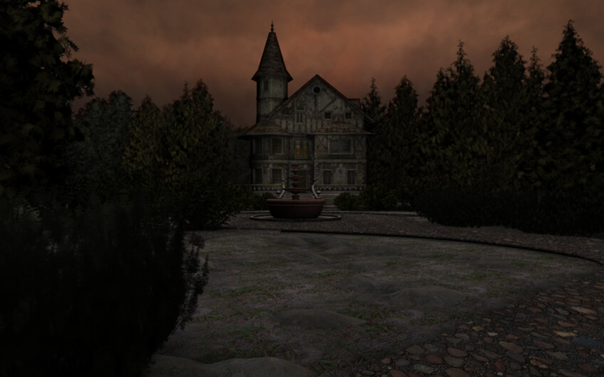

# SCream Redux

A reimplementation of the SCream engine used by *Scratches* (2006) and
*Scratches – Director's Cut* (2007). It runs the **original, unmodified game
scripts and data**: the compiled Lua scripts build the world through the
engine's `sc*` API, which this project reimplements in C++20 with SDL3 and
OpenGL. Behaviour comes from the scripts and from disassembling the original
`scream.exe`, not from guesswork; all 87 API functions are ported
(`scream --api-status` lists them).



*The Director's Cut's opening view, running in SCream Redux. The game's art is
© Nucleosys; it is shown here only to illustrate the engine.*

No game data is included. You need your own copy of the game.

## Status

Both releases are playable from start to finish: the Director's Cut (both
campaigns, the main game and The Last Visit) and the original 2006 release. The
automated player (`--explore`) plays each of them through to its ending.

Ported from the original:

- **World:** cube-map panoramas with the original camera, hotspots and close-ups.
- **Media:** Theora cutscenes; Vorbis sound, music (including surround tracks)
  and voices; subtitles.
- **Text:** feedback, subtitles, choices and the journal in the original's layout
  and monospaced font.
- **Screens:** the inventory with its tutorial hints, the journal, and the main
  and setup menus.
- **Effects:** the original's crossfades, gamma correction, sky, fog, rain,
  night, lightning and candlelight.
- **Controls:** the keyboard shortcuts, slideshow mode and alternate control.
- **Settings and saves:** `scream.cfg`, and saved games in the original file
  format.

The 2006 release's Lua 5.0 scripts are translated to Lua 5.1 as they load. When
it runs, the engine behaves as the 2006 executable did:

- its field of view and vertical look range
- 800×600 layout, so text wraps at about 70 characters
- an inventory 8 icons wide
- its menu
- generated clouds

See [NOTES.md](NOTES.md) for the reverse-engineering notes (with addresses in
`scream.exe`) and [HANDOFF.md](HANDOFF.md) for the project's state and workflow.

## Building

Requires CMake 3.24+, a C++20 compiler and SDL3 (`brew install sdl3` on macOS).
Lua 5.1.5, stb, libogg and libtheora are vendored in `third_party/` (see each `SOURCE.txt`).

```sh
cmake -S . -B build -DCMAKE_BUILD_TYPE=RelWithDebInfo
cmake --build build -j
```

## Game data

Unpack the installers (see NOTES.md; `unar` handles the NSIS installers and the
split 7z) so you have directories containing `scream.sc`, `scratches.sc`,
`scream.cfg` and the `.res` archives. For the updated Director's Cut:

```sh
./build/scream --data extracted/dc/install --data extracted/dc/update
```

Later `--data` directories override earlier ones, so the disc 2 update's
`scratches.sc` and `update.res` (HD textures) take precedence. For the 2006
release (scripts and `scream.res` from the installer, `scratches.res` from the disc):

```sh
./build/scream --data extracted/2006/install --data extracted/2006/disc
```

## Configuration: `scream.cfg`

The game's own `scream.cfg` (found in the data directories) is read the way the
original reads it, and every key takes effect:

| key | effect |
|---|---|
| SCRIPT | the game script (`SCRIPT.sc`, else `SCRIPT.lua`) |
| WIDTH, HEIGHT | the screen mode: the size of the window and the scale of every on-screen layout (the DC ships 1024×768, the 2006 release 800×600) |
| FULLSCREEN | start fullscreen (the mode is scaled to your display) |
| QUALITY | 0 gives nearest-pixel textures |
| VSYNC | 1 syncs to the display |
| SURROUND | also play the rear-channel music files |
| LOG | write `scream.log` in the save folder (the L key toggles it) |
| PATH, RESOURCE, LANGUAGE | as in the original |
| DEPTH, RATE, AUDIO_DEVICE, BUFFER_SIZE, NUM_BUFFERS, DEBUG | read, but they only affected Windows display and OpenAL setup |

The shipped files ask for fullscreen. Pass `--windowed` (or `--window WxH`) to
run in a window.

**Setup launcher.** Rather than editing the file by hand, open the setup window:
start with `--setup`, hold Option (macOS) or Alt (Windows) while the game starts,
or, on macOS, choose *Settings…* (⌘,) in the application menu while playing,
which opens it in a separate window next to the game. It edits the game's own
`scream.cfg` in place, keeping its comments, and keeps the shipped file as
`scream.cfg.orig` the first time you save. *reset* brings the shipped values back.
Click a setting (right-click to go back), or use the arrow keys and Return. It
also has this port's one addition to the file, `WIDESCREEN`: when it's on,
panoramas fill a window wider than 4:3; when it's off, they keep the original's
4:3 with black sides, like everything else. The original's own parser skips the
key, so the file still works with the original game. A running game notices
when the file is saved and applies the changes within a second: screen mode,
fullscreen, widescreen, vertical sync, textures and the log file at once,
surround music from the next track.

## Playing

Mouse:

- **Look around.** The Director's Cut starts with *alternate control* on: the
  view follows the mouse and the cursor stays in the middle. Turn it off in
  Setup to look around by moving the mouse to the screen edges instead, the
  2006 release's only mode. In *slideshow mode* (Setup), clicking an edge turns
  the view a step instead.
- **Interact.** Left-click.
- **Inventory.** Right-click opens and closes it. Left-click an item to pick it
  up, then left-click where to use it.

Keys, as `scream.exe` maps them:

| key | action |
|---|---|
| A / Left | turn left |
| D / Up | turn right |
| W / Right | look up |
| S / Down | look down |
| E / Space | look straight ahead |
| F1 | hints |
| F2 | surround music |
| F5 / F7 | quicksave / quickload |
| F9 / F10 | camera speed / text speed |
| F12 | gamma |
| L | log file on or off |

Esc closes the inventory, journal or overlay, or opens the menu. Esc or Space
skips a cutscene. As in the original, Esc also cuts short a line of narration or
dialogue the game is waiting on (each press skips one line), and in the
Director's Cut a scripted pause.

Extras of this port: middle-drag to look around, F11 for a screenshot.

**Saved games** go to the user data folder
(`~/Library/Application Support/SCreamRedux/Scratches` on macOS) as
`scream.001`–`scream.010` and `scream.011` (the quicksave), in the original
engine's own format. To carry on with saves from an original installation, copy
them into that folder. Director's Cut saves only work with the Director's Cut,
and 2006 saves only with the 2006 release. As in the original, a save's name is
whatever the game script gives it, such as "Garden, Day 1, 10am". This port's
earlier `slotN.sav` files still load.

Setup choices are kept in `settings.cfg` in the same folder (the original
forgot them), except slideshow mode, which starts off each time as in the
original. As in the original, a saved game also stores the setup choices made
while playing it, and loading it brings them back.

## Command line

```
--data DIR              a data directory (repeatable; later ones win)
--windowed / --fullscreen / --window WxH   override scream.cfg's mode
--setup                 open the setup launcher first
--game sdc|tlv          skip the menu and start a new game (main game or The Last Visit)
--start ROOM[:NODE]     skip the intro and start at a location, e.g. garden:n1
--save-dir DIR          keep saves and settings in DIR
--hotspots              draw clickable areas
--trace                 log every sc* call
--exec LUA              run Lua once startup is idle; debugClick(name) clicks an object
--screenshot FILE       write a PNG once the scene settles, then quit
--verify-media          decode every image, sound and video in the archives
--api-status            list all sc* functions and their state
```

Test tools (use `--save-dir` with a temporary folder so your saves are left alone):

```
--check                 check the world the script builds (targets, handlers, files)
--dump-world FILE       write the world the script builds as text (for comparing scripts)
--crawl                 click every hotspot, try every item, run every choice and dialogue
--explore [--explore-hints FILE]   with --game: play automatically to the end
--turbo                 no audio or video, game time fast-forwarded
```

## The editor: `scream-edit`

The original developers wrote each game as one hand-kept Lua file, with
world-building functions declared in a strict template (NOTES.md, "How the
scripts were written"). `scream-edit` reads that format back: it parses a
game script and turns its builder functions into rooms, nodes, close-ups,
hotspots, items, dialogues and tracks. Each change is written back in the
developers' own layout, and every other line of the file stays as it was.

```sh
./build/scream-edit --new ~/MyGame "My Game"     # a new playable game from the template
./build/scream-edit --data ~/MyGame               # edit it
./build/scream --data ~/MyGame                    # play it
```

- **Node view:** the panorama with its hotspots on the cube faces. Drag
  to look around, drag a hotspot to move or resize it, and use *New hotspot*
  to draw one (coordinates snap to the developers' 5-unit grid).
  Double-click a hotspot to follow it.
- **Zoom view:** close-ups with their hotspots, edited the same way.
- **Map:** the whole game, or one room. The original has no map of its own:
  each room is a separate set of nodes, and most doors are hotspots whose
  handler plays the door and calls `scSwitch(SC_ROOM, ...)`. So the game map
  follows those handlers (and plain `SC_ROOM` clicks) from the room a new
  game starts in. The room map lays out nodes and zooms by which hotspot
  leads where. Red marks a place no hotspot leads to.
- **Inspector:** every call that configures the selected element, with
  pickers for cursors, click actions, target nodes, zooms, rooms and
  handlers, and for item reactions. Drop an asset from the Assets tab onto a field.
- **Text:** type a hotspot's feedback, an item's label or a dialogue line
  as plain text. *to text table* moves it into the table of text globals at
  the top of the script, as the original keeps its text. *pick text* reuses
  an entry, and the Text tab adds and edits entries (a shared entry changes
  everywhere it's used).
- **Outline:** rooms, items, dialogue, choices, music, the text table,
  the code (each handler in an editor, with what uses it) and every asset.
- **Run:** *Check* (F6) runs the engine's `--check` on the script as it is
  now and lists the problems. *Play from here* (F5) starts the game at the
  open node. Ctrl/Cmd+S saves; undo and redo cover every edit.

A new game is a folder in the original's layout: `scream.cfg`, `scream.sc`
(the engine's constants), `game.lua`, an `assets/` folder and `game.res`,
which is packed from `assets/` before each check or run. The template is a
small room with a door, a desk and a key; all its art (cursors, font, menu,
test-room panoramas) is generated by the editor, so no game data is needed.
`--import-panorama IMAGE OUTDIR BASE` cuts an equirectangular panorama into
the six faces of a node. The scripts are plain Lua, which the original
`scream.exe` can also load (its Lua parser is built in), though that hasn't
been tried.

To study Scratches itself, open a decompiled script with the game's data:
`./build/scream-edit --data extracted/dc/install --data extracted/dc/update
extracted/decompiled/dc/scratches.lua` (work on a copy).

## Known limits

Not yet verified:

- **Saved games** follow the original writer's code but haven't been checked
  against a file the original executable made.
- **Fade lengths** in the original depended on the player's Windows timer
  setting, so they varied between PCs. Here a fade of F lasts F seconds from
  full volume, which is what the game's scripts and playlist were written for.

Fixes of problems in the original:

- Slideshow mode together with alternate control was unusable in the original
  (the cursor stuck in the middle, clicks nudging the view). Here slideshow mode
  wins: the cursor follows the mouse and edge clicks turn the view a step.
- The hall telephone's close-up was never shown in either release: the lobby
  defines a close-up with the same name, and the original always opened that
  one, so the hall's clock, which only its own copy has, could never be looked
  at. Here a room's own close-up comes first.
- Taking the rag in the cellar (The Last Visit) left it visible from the other
  side of the room, because of a typo in the script that stopped the handler.
  The handler runs as intended here.

Deliberate differences:

- The screen mode is scaled to your window or display instead of switching the
  display resolution. Panoramas fill a widescreen window unless `WIDESCREEN` is
  0; everything else stays 4:3.
- Loading a game starts from a clean start-of-game state before applying the
  file.

These lists are kept in full in [NOTES.md](NOTES.md).
